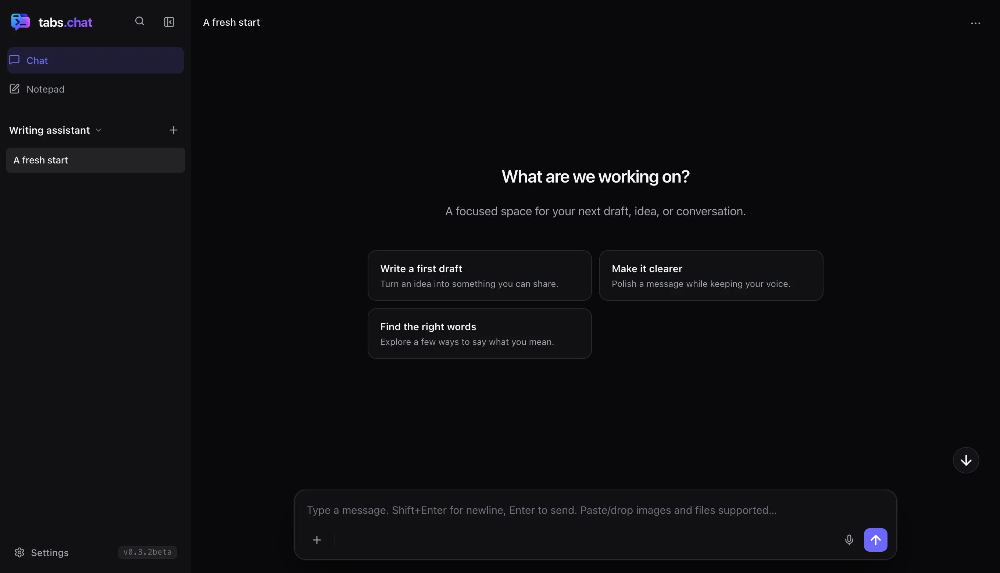

# tabs.chat

**Your AI workspace, one link away.**

Connect cloud or local models, add instructions and MCP tools, and organize them into agents. Share a ready-to-use configuration through a link—or let an AI agent create one for you.

Runs entirely in your browser, including as a single portable HTML file. No tabs.chat account or application backend is required.



## Get started

1. Open [tabs.chat](https://tabs.chat), or save the [Normal HTML](https://github.com/caporro/tabs.chat/releases/download/v0.3.2-beta.1/tabs-chat.html) or [Lite HTML](https://github.com/caporro/tabs.chat/releases/download/v0.3.2-beta.1/tabs-chat-lite.html) and open it in your browser. No installation or build is needed to use a generated file.
2. Open **Settings**, select an agent, and connect a provider under **AI services**. Enter your API key or your local server address and choose a model.
3. Return to the chat and start a conversation. Customize **Instructions**, **Tools**, and the **Welcome screen** whenever you need them.

The HTML includes its supporting resources. Cloud models need network access; local models need a running compatible server. Provider accounts, credentials and usage charges depend on the service you choose.

For browser hosting or local HTTP access, see [deployment](docs/deployment.md). Both portable editions are attached to [GitHub Releases](https://github.com/caporro/tabs.chat/releases).

## Normal and Lite

Both editions include chat, MCP tools, notes, Markdown, highlighted code, images and text/code attachments.

| Capability | Normal | Lite |
| --- | --- | --- |
| Mermaid diagrams and mathematical formulas | Rendered | Shown as text |
| PDF and Word (.docx) text extraction | Included | Not included |
| Distribution | Single HTML file | Smaller single HTML file |

Agents, shared links and JSON backups use the same format in both editions. Read more about [distribution and dependencies](docs/dependencies.md).

## Create and share an agent

An agent groups its own AI connections, models, instructions, tools, welcome prompts and conversations. Create separate agents for writing, coding or any other workflow.

In **Settings**, select an agent and use **Share** beside its name to generate a link, optionally protected by a password. The recipient opens the link to import the configuration. Conversations and notes are not included; keys and custom headers are excluded unless you explicitly include credentials.

**AI agents can generate these links on demand.** The [link format reference and ready-to-use generator](docs/link-format.md) explain the supported fields, encoding and password protection.

Agent instructions support variables for names, date/time, model details and custom values. A global user name overrides the agent’s default. See the [user guide](docs/user-guide.md) and [prompt variable reference](docs/prompt-variables.md).

## Features

- **Cloud and local models:** OpenAI, Anthropic Claude, Google Gemini, Ollama, LM Studio and OpenAI-compatible endpoints, with streaming responses and model discovery.
- **Rich conversations:** Markdown, highlighted code with copy buttons, collapsible reasoning, image input and file attachments. Normal adds diagrams, formulas and PDF/DOCX extraction.
- **Tools:** Built-in date/time, calculator, web fetch and notes tools, plus MCP servers and multi-turn tool execution with compatible models.
- **Notes and context:** A shared Markdown notepad, `@` note attachments, conversation instructions and automatic memory summarization.
- **Everyday controls:** Search chats and notes, inspect requests and usage, export/import JSON backups, and use light, dark or system appearance on desktop and mobile.

## Privacy and browser access

Settings, API keys and chat histories are saved in your browser's localStorage. Saved keys are not encrypted by the app. There is no tabs.chat tracking or application backend; messages and credentials go to the services you configure. Password protection encrypts the shared link payload, not your browser storage.

Connections are subject to browser CORS rules. Settings shows browser access observations for each provider and MCP server. An optional proxy you choose receives the forwarded requests, including credentials and content; it is off by default and has no automatic fallback. See [browser access and CORS](docs/browser-access.md).

The built-in **web fetch** tool uses `r.jina.ai` to retrieve the requested URL. Disable that tool in Settings if you do not want to use this external service.

## Development

Use Node.js 22.13+ and npm:

```sh
npm ci --ignore-scripts
npm run build
```

This builds both standalone editions. The [development guide](docs/development.md) covers the source layout, individual builds, local preview and checks. The [deployment guide](docs/deployment.md) covers static hosting and the included AWS scripts. Dependency updates and license details are in [dependencies](docs/dependencies.md).

## Beta status

MCP support currently uses HTTP POST with JSON/SSE responses. Full session lifecycle handling, tool-list pagination and a direct remote-agent chat mode are not yet implemented. Compatibility depends on the server; see [MCP limitations](docs/browser-access.md#mcp-compatibility).

PWA installation support is planned for a later release. Browser checks use local fixtures; they do not establish compatibility with every live provider or browser.

## License

[MIT](LICENSE). Bundled libraries retain their own licenses; full texts and source references are in [THIRD_PARTY_NOTICES.txt](THIRD_PARTY_NOTICES.txt) and [dependency notes](docs/dependencies.md). **About → Third-party licenses** exports the notices offline.
